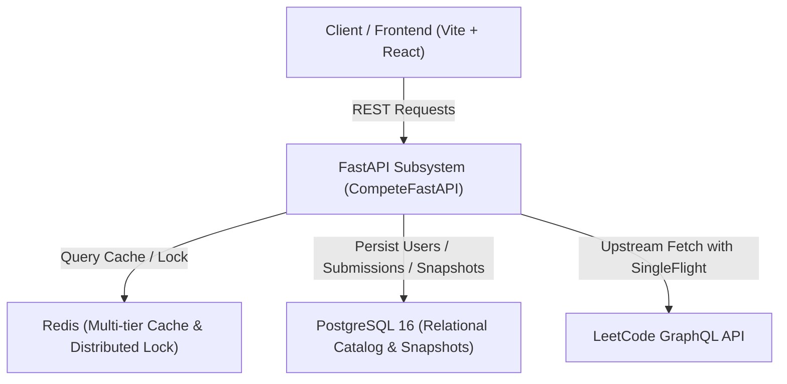

# Compete: Head-to-Head Developer Duel Platform

`Compete` is a high-performance developer analytics and duel comparison engine based on LeetCode public performance metrics. It provides normalized GraphQL proxying, multi-factor duel scoring, solving velocity analytics, and time-series progress tracking.

---

## Architecture Overview



### Core Subsystems:
* **`CompeteFastAPI/`**: Python 3.12+ FastAPI backend implementing async SQLAlchemy 2.0, Redis caching with in-memory LRU fallback, SingleFlight request deduplication, distributed APScheduler background sync, and SlowAPI rate limiting.
* **`CompeteFrontend/`**: React + Vite single-page application for rendering duel comparisons, stats breakdown, and progress charts.

---

## Backend API Endpoints

| Method | Endpoint | Description |
| :--- | :--- | :--- |
| `GET` | `/health` / `/api/health` | Comprehensive deep healthcheck (Postgres, Redis, Scheduler, Upstream LeetCode). |
| `GET` | `/api/users/{username}` | Normalized user profile, difficulty breakdown, rankings, and topic areas. |
| `GET` | `/api/users/{username}/activity` | Recent submission activity stream with timestamps and language. |
| `GET` | `/api/users/{username}/problems` | List of solved problems with catalog associations. |
| `GET` | `/api/users/{username}/history` | Historical time-series snapshots with pagination (`limit`, `offset`, `from_date`, `to_date`). |
| `GET` | `/api/compare/{user1}/{user2}` | Head-to-head duel comparison computing multi-factor score and metrics. |

---

## Local Development Setup

### Prerequisites
* Python 3.12+
* Docker & Docker Compose
* Redis and PostgreSQL (or Dockerized instances)

### Setup & Run Backend

1. Navigate to the backend directory and configure virtual environment:
   ```bash
   cd CompeteFastAPI
   python -m venv .venv
   source .venv/bin/activate
   pip install -r requirements.txt
   ```

2. Start PostgreSQL and Redis via Docker Compose:
   ```bash
   docker compose up -d postgres redis
   ```

3. Run database migrations:
   ```bash
   alembic upgrade head
   ```

4. Launch FastAPI development server:
   ```bash
   uvicorn app.main:app --reload --port 8000
   ```

---

## Running the Automated Test Suite

```bash
cd CompeteFastAPI
.venv/bin/pytest -v
```

---

## Deployment (Docker Compose)

To run the complete production backend stack:
```bash
cd CompeteFastAPI
docker compose up -d --build
```
The API is exposed at `http://localhost:8000` with interactive OpenAPI documentation at `http://localhost:8000/docs`.